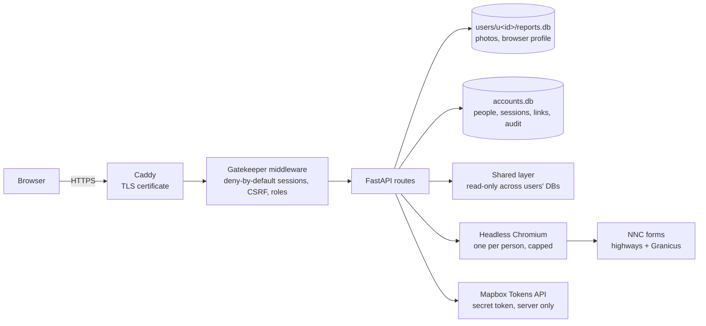

# NNC Reporter — the web app

**Status:** on branch `claude/epic-galileo-5isqji` for testing before it is merged.

This note covers how the multi-user web version is built, why, and what still needs
checking against the real council sites.

## 1. Shape

The whole app runs in one container with a data volume:

- **One process.** No extra services are needed for a group of tens of people.
- **SQLite per person, plus one accounts database.** Each person's reports are in
  their own file, so a forgotten `WHERE user_id = ?` cannot leak data between them,
  and an export or erasure is just that folder.
- **Moving to Postgres and S3 later.** The AWS requirements document sets out how to
  do this if the group grows to need several servers. The routes would stay as they
  are.

**The reporting modules are unchanged.** `photos`, `geo`, `classify`, `routing`,
`submit`, `kml`, `track` and `dashboard` keep working as they always have. The web
layer binds the signed-in person's data folder to the request through a context
variable (`config.use_user`), so `config.data_dir()` returns that person's folder
everywhere, including in threads the request starts.

## 2. Sign-in, and why it cannot be bypassed

| Threat | Control |
|---|---|
| Forgotten check on a new route | `auth.Gatekeeper` refuses every request without a full session, except an explicit list of sign-in pages and assets. A test walks every route. |
| Weak or reused passwords | 12+ characters with all four character types. No name or email in it, no sequences. zxcvbn score ≥ 3. Have I Been Pwned k-anonymity check. |
| Password database theft | Argon2id (64 MiB, t=3). Session and link tokens are stored as SHA-256 hashes. Council passwords are Fernet-encrypted with a key derived from `NNC_SECRET_KEY`. |
| Guessing | Per-account lockout (5 tries, 15 min, doubling) with an email to the owner. Per-IP throttle. Identical failure messages and timing for unknown accounts. |
| Phished password | TOTP two-factor: required for admins, optional (or required) for all. Codes can't be replayed. Hashed one-time recovery codes. |
| Session theft or fixation | 256-bit session ids, rotated at every sign-in step. `HttpOnly`, `Secure`, `__Host-` cookies. 2 h idle and 12 h absolute limits. A password change ends other sessions. |
| Cross-site requests | Origin check on every change, plus a per-session CSRF token header. `SameSite=Lax`. No CORS. |
| Clickjacking, injection | `frame-ancestors 'none'`, CSP, `nosniff`, output escaping. Uploads are re-read as images, never trusted by name. |
| Privilege misuse | Roles are checked twice: by the gatekeeper (`/admin*`, viewer writes) and on each route. An admin can't demote or remove themselves, or remove the last admin. |
| Server-side request forgery | Imported My Map links and photos are fetched only over https, to public addresses (`nncr/netsafe.py`). The server's browser only loads council sites. |
| Audit | Sign-ins, failures, locks, invitations, role changes, resets, two-factor changes and each "Submit to council" approval. |

**Not covered here.** Encryption at rest of the data volume is left to the host (use
an encrypted disk). The CSP still allows inline scripts, because the existing pages use
inline handlers. Moving those into script files would let the CSP drop
`'unsafe-inline'`.

## 3. Processing reports "at the web level"

The council offers no API, so reports go in through its web forms. Three ways were
weighed (see the AWS requirements document, §3):

- **A — streamed remote browser.**
- **B — local agent.**
- **C — server presses Submit after approval.**

What is built is **C with a real review**, which also covers most of A.

- The server's headless Chromium runs the same walker as the desktop tool and stops at
  each form's Submit button.
- The app shows a screenshot of each filled form and every value in its fields.
- Submit is pressed only when the person presses **Submit to council** for that
  report. The approval is audited.
- A **live view** (screenshots, plus clicks, typing and scrolling sent back) lets a
  person finish any form the walker could not, without a VNC stack.
- One run per person and `NNC_MAX_BROWSERS` across the server, to protect both the
  server and the council's forms. Unused forms close after 15 minutes.
- The browser is confined to `*.northnorthants.gov.uk` (plus the Granicus hosting
  domains). Anything else is refused and logged.

**Risks to watch:**

- **The council's sites may treat datacentre traffic differently.** If that happens,
  run the app on a home connection (desktop mode, `NNC_SUBMIT_MODE=visible`), or
  build option B.
- **Granicus may frame its forms from a host not on the allow-list.** If a form stops
  with "refused to open …", add that host to `NNC_BROWSER_ALLOWED_HOSTS`.
- **Tell the council.** It would be courteous to let them know the group reports
  through this tool, as the requirements document suggests (D-8).

## 4. Mapbox

The secret token (`MAPBOX_SECRET_TOKEN`) is only ever read on the server.

- **Browser tokens.** Browsers get temporary `tk.` tokens from
  `POST /tokens/v2/{username}`. The username is read from the token itself. Scopes are
  `styles:read styles:tiles fonts:read datasets:read vision:read`, falling back to the
  first three. Each lasts 59 minutes, is cached server-side, and is renewed by the
  pages 10 minutes before it expires.
- **Requirement.** The secret token must carry `tokens:write`.
- **Checks.** Code paths never return an `sk.` value, and a test asserts no page
  contains one.
- **URL restrictions.** These apply only to public tokens and check the page's own
  address. To add a public fallback (`MAPBOX_PUBLIC_TOKEN`), restrict it to the app's
  `NNC_BASE_URL`.

## 5. The shared layer

A report joins the shared layer when it has gone to the council: status submitted,
mapped or completed. `aggregate.collect()` reads each person's database read-only,
caches by file modification time, and tags every report with its unitary ward, parish
or town council, and town council ward (`boundaries.locate`). That feeds:

- the shared map (`/map`);
- the summary tables (`/summary`, `/api/org/summary?by=…`);
- downloads as CSV, GeoJSON and KML;
- the group-wide duplicate warning at upload.

Names show only for people who opt in. Admins always see them.

## 6. Boundaries

| Layer | Source | Notes |
|---|---|---|
| Council (E06000061) | ONS `LAD_MAY_2025_UK_BFC_V2` | Worked out from the wards if that service fails |
| Unitary wards | ONS `WD_MAY_2025_UK_BFC_V2` | 31 wards; the bundled file is used until fetched |
| Parishes / town councils | ONS `PARNCP_DEC_2025_EW_BFC` | Town councils are an admin-editable list |
| Town council wards | Derived (parish ∩ unitary ward), or uploaded | Uploads replace derived wards per town; the app works out which differ |

The service URLs can be overridden with `NNC_ONS_LAD_URL`, `NNC_ONS_WARDS_URL` and
`NNC_ONS_PARISHES_URL` if ONS republishes them under new names. The fetch filters
features by council code where the source has one, and otherwise by position inside
the council.

## 7. Still to check before relying on it

1. **Run one real submission of each form type** from the server: highways,
   fly-tipping, bins, and one environmental form. Watch the log and the live view.
2. **Fetch the boundaries** on the server, then check the town council list and the
   town council wards. Kettering Town and Rushden in particular need their official
   ward boundaries uploaded.
3. **Confirm the Mapbox secret token has `tokens:write`** (Admin → Test the Mapbox
   token).
4. **Set up SMTP and send yourself** an invitation and a password reset.
5. **Review `/privacy`** and add the data controller's name and contact.
6. **Import your desktop history** with `manage import-local`, and check the counts.
